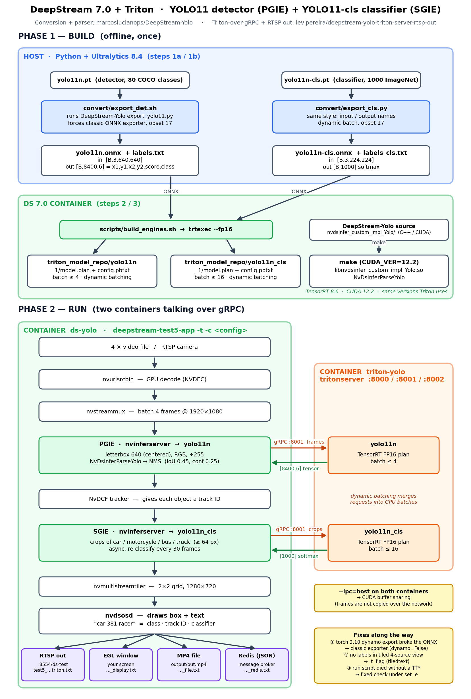

# DeepStream 7.0 + Triton: YOLO11 PGIE + YOLO11-cls SGIE

Ultralytics **YOLO11n** detects objects (PGIE). The NvDCF tracker gives each one an ID, and Ultralytics **YOLO11n-cls**
classifies every vehicle crop (SGIE). Both models are served by a separate **Triton Inference Server** that
DeepStream calls over **gRPC**. The pipeline runs in **`deepstream-test5-app`**. Output goes to an **RTSP stream**, an
**on-screen window** or an **MP4 file**, and every detection and classification can be sent as **JSON to a message
broker** (Redis here, Kafka works the same way).



(Regenerate the image with `python3 docs/make_flowchart.py`.)

| | |
|---|---|
| Docker image | `nvcr.io/nvidia/deepstream:7.0-triton-multiarch` (DeepStream 7.0, Triton 2.39 / 23.10, TensorRT 8.6, CUDA 12.2) |
| GPU tested | NVIDIA GeForce GTX 1650 Ti (4 GB, Turing), driver 590.48 |
| Host tools | Python 3.10, Ultralytics 8.4.14, torch 2.10, onnx, onnxslim, onnxruntime |
| Conversion + parser | [marcoslucianops/DeepStream-Yolo](https://github.com/marcoslucianops/DeepStream-Yolo) |
| Triton-over-gRPC + RTSP-out config style | [levipereira/deepstream-yolo-triton-server-rtsp-out](https://github.com/levipereira/deepstream-yolo-triton-server-rtsp-out) |

---

## Quick start (everything is already built)

```bash
cd ds7-yolo11-triton-rtsp
./scripts/start_triton_server.sh                                        # 1. start Triton (container: triton-yolo)

./scripts/run_deepstream.sh test5_yolo11_triton_display.txt    # 2a. window on your screen
./scripts/run_deepstream.sh                                             # 2b. RTSP -> ffplay rtsp://localhost:8554/ds-test
./scripts/run_deepstream.sh test5_yolo11_triton_file.txt       # 2c. MP4  -> output/out.mp4
./scripts/start_redis.sh && ./scripts/run_deepstream.sh test5_yolo11_triton_redis.txt   # 2e. RTSP + JSON messages to Redis

./scripts/run_wayland_native.sh                                     # 2d. native Wayland window (see docs/WAYLAND_GUIDE.md)

docker stop ds-yolo ds-wayland   # stop DeepStream (or Ctrl+C when run in a terminal)
docker stop triton-yolo    # stop Triton
docker stop redis-ds       # stop Redis
```

---

## Folder layout

```
ds7-yolo11-triton-rtsp/
├── convert/                          # Step 1 (host)
│   ├── export_yolo11.py              #   DeepStream-Yolo exporter (unmodified)
│   ├── export_det.sh                 #   wrapper: forces the classic ONNX exporter, opset 17
│   ├── export_cls.py                 #   classifier exporter in the same style
│   ├── yolo11n.pt / yolo11n.onnx / labels.txt
│   └── yolo11n-cls.pt / yolo11n-cls.onnx / labels_cls.txt
├── triton_model_repo/                # Step 2 (DS container)
│   ├── yolo11n/      config.pbtxt  1/model.plan    # PGIE engine, batch <= 4
│   └── yolo11n_cls/  config.pbtxt  1/model.plan    # SGIE engine, batch <= 16
├── nvdsinfer_custom_impl_Yolo/       # Step 3: DeepStream-Yolo parser -> libnvdsinfer_custom_impl_Yolo.so
├── configs/                          # Step 5
│   ├── config_pgie_yolo11_triton.txt          # nvinferserver PGIE (gRPC)
│   ├── config_sgie_yolo11_cls_triton.txt      # nvinferserver SGIE (gRPC)
│   ├── config_*_nocudashare.txt               # same, CUDA buffer sharing off (native Wayland / gst-launch)
│   ├── test5_yolo11_triton.txt                # deepstream-test5-app pipeline, RTSP out
│   ├── test5_yolo11_triton_display.txt        # same, on-screen window
│   ├── test5_yolo11_triton_file.txt           # same, MP4 out, no loop (testing)
│   ├── test5_yolo11_triton_redis.txt          # same as RTSP + message broker sink (JSON -> Redis)
│   ├── msgconv_config.txt                     # sensor/place/analytics info put into the JSON messages
│   ├── labels.txt                             # 80 COCO classes, one per line
│   └── labels_cls.txt                         # 1000 ImageNet classes, one line, ';' separated
├── scripts/
│   ├── build_engines.sh              # Step 2: ONNX -> TensorRT FP16 plans
│   ├── start_triton_server.sh        # Step 4: Triton container
│   ├── run_deepstream.sh             # Step 5: DeepStream container (deepstream-test5-app)
│   ├── start_redis.sh                # local Redis message broker (for *_redis.txt)
│   └── run_wayland_native.sh         # native Wayland window (gst-launch + waylandsink)
├── docs/  pipeline_flowchart.png  make_flowchart.py  WAYLAND_GUIDE.md (+ .html)
└── output/                           # out.mp4, logs
```

---

## The full flow, step by step

### Step 1: Convert Ultralytics `.pt` to DeepStream-style ONNX (host)

```
yolo11n.pt ──► export_det.sh ──► export_yolo11.py (DeepStream-Yolo) ──► yolo11n.onnx + labels.txt
yolo11n-cls.pt ──► export_cls.py ──────────────────────────────────────► yolo11n-cls.onnx + labels_cls.txt
```
```bash
cd convert
./export_det.sh yolo11n.pt          # detector
python3 export_cls.py -w yolo11n-cls.pt   # classifier
```
- **Detector.** DeepStream-Yolo's exporter patches Ultralytics' box decoding (`dist2bbox`) and appends a
  `DeepStreamOutput` layer. The ONNX output becomes `output [B, 8400, 6]` = `x1, y1, x2, y2, score, class`
  in 640×640 network pixels, which is exactly what `NvDsInferParseYolo` reads.
  A plain `yolo export format=onnx` gives `[B, 84, 8400]` instead, which this parser cannot read.
- **Classifier.** DeepStream-Yolo has no classifier exporter, so `export_cls.py` does the same thing:
  input `input [B,3,224,224]`, output `output [B,1000]`. The output is already softmax, because the Ultralytics
  `Classify` head runs softmax in export mode.
- Only the **batch** dimension is dynamic, so Triton can batch frames (PGIE) and crops (SGIE).
- Verified with onnxruntime on `bus.jpg`. The detector finds the bus at `87,135 → 554,436` with score 0.9, class 5 (bus).
  The classifier on that crop gives trolleybus/streetcar-type classes, and the softmax sums to 1.0.

### Step 2: Build TensorRT engines and the Triton model repo (DS container)

```
yolo11n.onnx     ──► trtexec --fp16, batch 1/4/4   ──► triton_model_repo/yolo11n/1/model.plan
yolo11n-cls.onnx ──► trtexec --fp16, batch 1/8/16  ──► triton_model_repo/yolo11n_cls/1/model.plan
```
```bash
docker run --rm --gpus all --entrypoint bash -u $(id -u):$(id -g) -v $PWD:/app -w /app \
  nvcr.io/nvidia/deepstream:7.0-triton-multiarch -c ./scripts/build_engines.sh   # add --force to rebuild
```
- Engines are built **inside the same image Triton runs from**. A TensorRT plan only loads with the
  exact TensorRT version that built it.
- `config.pbtxt` tells Triton the tensor names and shapes, `max_batch_size`, and **`dynamic_batching`**. Triton
  merges small requests into one GPU batch, which helps most for the SGIE, where the crop count changes every frame.
- The batch sizes (4 frames, 16 crops) and the `n` models were chosen to fit the 4 GB GPU.

### Step 3: Compile the DeepStream-Yolo parser library (DS container)

```bash
docker run --rm --entrypoint bash -u $(id -u):$(id -g) -v $PWD:/app -w /app \
  nvcr.io/nvidia/deepstream:7.0-triton-multiarch \
  -c "export CUDA_VER=12.2; make -C nvdsinfer_custom_impl_Yolo clean && make -C nvdsinfer_custom_impl_Yolo"
```
- Triton returns raw numbers. `NvDsInferParseYolo` turns the `[8400,6]` tensor into DeepStream objects,
  dropping anything below the confidence threshold. nvinferserver then runs NMS.
- `CUDA_VER=12.2` matches DeepStream 7.0 (x86).
- The classifier needs no custom parser, because nvinferserver's built-in classification post-processing reads softmax output.

### Step 4: Start the Triton Inference Server (separate container)

```bash
./scripts/start_triton_server.sh
curl localhost:8000/v2/health/ready                      # HTTP 200 = ready
curl -s -X POST localhost:8000/v2/repository/index       # both models "READY"
```
- Container `triton-yolo`, ports **8000** HTTP, **8001** gRPC (used by DeepStream), **8002** Prometheus metrics.
- `--disable-auto-complete-config`: Triton uses our `config.pbtxt` exactly as written.
- `--ipc=host` (on both containers) lets nvinferserver share CUDA buffers with Triton
  (`enable_cuda_buffer_sharing: true`), so frames aren't copied through the gRPC socket.

### Step 5: Run DeepStream (second container)

```
4 × file/RTSP ─► nvurisrcbin (NVDEC) ─► nvstreammux (batch 4, 1920×1080)
   ─► PGIE nvinferserver ──gRPC──► Triton yolo11n      ─► [8400,6] ─► NvDsInferParseYolo ─► NMS
   ─► NvDCF tracker (track IDs)
   ─► SGIE nvinferserver ──gRPC──► Triton yolo11n_cls  ─► [1000] softmax ─► top label
   ─► tiler 2×2 (1280×720) ─► nvdsosd ("car 381 racer") ─► RTSP | EGL window | MP4
   └► nvmsgconv (every 30 frames) ─► nvmsgbroker ─► Redis stream "ds-yolo11" (JSON)      [*_redis.txt only]
```
```bash
./scripts/run_deepstream.sh [config]
```
The script runs `deepstream-test5-app -t -c <config>` in container `ds-yolo` with:
- `--net=host`, to reach Triton at `127.0.0.1:8001`, Redis at `localhost:6379`, and publish RTSP on host port 8554
- `--ipc=host`, for CUDA buffer sharing with Triton
- `DISPLAY` + `/tmp/.X11-unix`, for the on-screen window
- `-u $(id -u):$(id -g)`, so output files belong to you, not root
- `-t`, so labels are drawn in the tiled multi-source view (see Problem 2)

Each box is labelled **`<class> <track ID> <classifier label>`**, e.g. `car 381 racer`, `person 171`.

### Step 6: Watch

| Config | Output |
|---|---|
| `test5_yolo11_triton_display.txt` | window on your screen (EGL sink) |
| `test5_yolo11_triton.txt` | `ffplay rtsp://localhost:8554/ds-test` or VLC → Media → Open Network Stream |
| `test5_yolo11_triton_file.txt` | `output/out.mp4` (stops at end of file) |
| `test5_yolo11_triton_redis.txt` | RTSP as above **+** JSON in Redis: `docker exec redis-ds redis-cli --raw XREVRANGE ds-yolo11 + - COUNT 1` |
| `scripts/run_wayland_native.sh` (gst-launch, not deepstream-test5-app) | native Wayland window, see [Wayland section](#showing-the-output-on-a-wayland-desktop) |

**Measured on the GTX 1650 Ti, 4 × 1080p streams:** about **70 FPS per stream (≈280 FPS total)** to MP4 with `sync=0`,
and 30 FPS per stream (real time) for RTSP and the window, which use `sync=1`.

---

## Showing the output on a Wayland desktop

*(Also available as a standalone blog post: [docs/WAYLAND_GUIDE.md](docs/WAYLAND_GUIDE.md).)*

Ubuntu now uses **Wayland** for its desktop by default. Most DeepStream examples assume **X11**, so the first
question is: *how do I get the DeepStream window onto my screen?* There are two ways, both tested here.
The problems hit on the native route are Problems 10–12 below.

| | Route A: through XWayland | Route B: native Wayland |
|---|---|---|
| Video sink | `nveglglessink` (NVIDIA, X11 only) | `waylandsink` (standard GStreamer) |
| Works with `deepstream-test5-app` | ✅ yes (`[sink] type=2`) | ❌ no Wayland sink type, so use `gst-launch-1.0` or your own app |
| Speed (4 × 1080p, GTX 1650 Ti) | 30 FPS per stream (real time) | ~28 FPS at the end of a 30 s run, 19 FPS average; some frames dropped |
| Frames stay on GPU | ✅ | ❌ copied to CPU memory for Wayland |
| Script | `scripts/run_deepstream.sh test5_yolo11_triton_display.txt` | `scripts/run_wayland_native.sh` |

**Short answer:** use **Route A** day to day. It's faster and works with `deepstream-test5-app`. Use **Route B** when you need
a true Wayland client, e.g. no XWayland on the system, or a kiosk/compositor setup.

---

### Step 0: Check that you're on Wayland

```bash
echo $XDG_SESSION_TYPE        # wayland
echo $WAYLAND_DISPLAY         # wayland-0
echo $XDG_RUNTIME_DIR         # /run/user/1000
ls -la $XDG_RUNTIME_DIR/wayland-0   # srwxrwxr-x ... wayland-0   <- the Wayland socket
echo $DISPLAY                 # :0  <- XWayland is also running (needed for Route A)
ls /tmp/.X11-unix             # X0 ...
```

Wayland is just a **socket file**. A program that can reach `/run/user/1000/wayland-0` and is allowed to talk to it
can open a window. Docker containers can't see that file unless you mount it in.

---

### Route A: XWayland (recommended)

```
DeepStream (nveglglessink, X11) ──► /tmp/.X11-unix/X0 ──► XWayland (:0) ──► Wayland desktop
```

**Why.** NVIDIA's `nveglglessink` on x86 only knows X11. Its own help text says window creation
*"is currently only supported when the sink is used under X11"*. Ubuntu runs **XWayland**, a translator that pretends
to be an X11 screen and shows those windows on the Wayland desktop.

#### A1. Allow local programs to open windows
```bash
xhost +local:
```

#### A2. Give the container the X11 screen
```bash
docker run ... \
  -e DISPLAY=$DISPLAY \
  -v /tmp/.X11-unix:/tmp/.X11-unix \
  ...
```

#### A3. Use the EGL sink in the deepstream-test5-app config
```ini
[sink2]
enable=1
type=2        # EglSink
sync=1
```

#### A4. Run
```bash
./scripts/run_deepstream.sh test5_yolo11_triton_display.txt
```
That's the whole route. It ran at 30 FPS per stream with labels on every box (`deepstream-test5-app -t`).

---

### Route B: native Wayland with `waylandsink`

```
DeepStream ─► nvdsosd ─► nvvideoconvert (GPU→CPU, BGRx) ─► waylandsink ─► /tmp/wayland-0 ─► Wayland desktop
```

#### B1. Check that the plugin is in the image
```bash
docker run --rm --entrypoint gst-inspect-1.0 nvcr.io/nvidia/deepstream:7.0-triton-multiarch waylandsink
```
It's there (`waylandsink: wayland video sink`), along with `libwayland-client`.

#### B2. Smoke test: a test pattern in a Wayland window
```bash
docker run --rm \
  -u $(id -u):$(id -g) \
  -e WAYLAND_DISPLAY=wayland-0 \
  -e XDG_RUNTIME_DIR=/tmp \
  -v $XDG_RUNTIME_DIR/wayland-0:/tmp/wayland-0 \
  --entrypoint gst-launch-1.0 nvcr.io/nvidia/deepstream:7.0-triton-multiarch \
  videotestsrc num-buffers=90 ! video/x-raw,width=640,height=360,framerate=30/1 ! waylandsink
```
A color-bar window should appear for 3 seconds. Three settings matter here:

| Setting | Why |
|---|---|
| `-v $XDG_RUNTIME_DIR/wayland-0:/tmp/wayland-0` | puts the Wayland socket inside the container |
| `-u $(id -u):$(id -g)` | the socket only accepts **your** user, not root |
| `-e XDG_RUNTIME_DIR=/tmp` | must be a **writable** folder (see Problem 10) |

#### B3. The DeepStream pipeline
`deepstream-test5-app` can't output to Wayland, so build the same pipeline with `gst-launch-1.0`:
```bash
gst-launch-1.0 -e \
  nvstreammux name=m batch-size=4 width=1920 height=1080 batched-push-timeout=40000 ! \
  nvinferserver config-file-path=config_pgie_yolo11_triton_nocudashare.txt batch-size=4 ! \
  nvtracker ll-lib-file=.../libnvds_nvmultiobjecttracker.so ll-config-file=.../config_tracker_NvDCF_perf.yml ! \
  nvinferserver config-file-path=config_sgie_yolo11_cls_triton_nocudashare.txt ! \
  nvmultistreamtiler rows=2 columns=2 width=1280 height=720 ! \
  nvvideoconvert ! nvdsosd ! \
  nvvideoconvert ! "video/x-raw,format=BGRx" ! waylandsink sync=true \
  uridecodebin uri=file:///.../sample_1080p_h264.mp4 ! m.sink_0 \
  ...  (sink_1 .. sink_3)
```
Why each piece is there:
- **`nvvideoconvert ! video/x-raw,format=BGRx`**: DeepStream frames live in GPU memory (NVMM). `waylandsink`
  needs ordinary CPU memory in a format Wayland understands, so this element copies and converts them.
- **`*_nocudashare.txt` configs**: same as the normal configs but with `enable_cuda_buffer_sharing: false` (see Problem 12).

#### B4. Run it
```bash
./scripts/start_triton_server.sh     # if Triton isn't running yet
./scripts/run_wayland_native.sh      # opens a native Wayland window
```
Stop with Ctrl+C or `docker stop ds-wayland`.

**Result:** 901 frames rendered in a 30-second test, about 28 FPS per tile by the end and 19 FPS on average. Some
frames were dropped, because `sync=true` throws away frames that arrive late, mostly during startup.

### Wayland cheat sheet

```bash
# Route A: XWayland (fast, deepstream-test5-app)
xhost +local:
docker run ... -e DISPLAY=$DISPLAY -v /tmp/.X11-unix:/tmp/.X11-unix ...   # + [sink] type=2

# Route B: native Wayland (gst-launch + waylandsink)
docker run ... -u $(id -u):$(id -g) \
  -e WAYLAND_DISPLAY=wayland-0 -e XDG_RUNTIME_DIR=/tmp \
  -v $XDG_RUNTIME_DIR/wayland-0:/tmp/wayland-0 ...
# pipeline end:  ... nvdsosd ! nvvideoconvert ! "video/x-raw,format=BGRx" ! waylandsink
```

| Symptom | Cause | Fix |
|---|---|---|
| `failed to activate bufferpool` (waylandsink) | `XDG_RUNTIME_DIR` not writable | `XDG_RUNTIME_DIR=/tmp`, socket at `/tmp/wayland-0` |
| `Could not connect to Wayland display` / permission denied | socket not mounted, or wrong user | mount the socket, `-u $(id -u):$(id -g)` |
| `Failed to register CUDA shared memory … invalid device context` | CUDA IPC under gst-launch | `enable_cuda_buffer_sharing: false` |
| Window works but no labels (Route A) | `deepstream-test5-app` hides text in tiled view | `deepstream-test5-app -t` |
| No window at all (Route A) | X access not allowed | `xhost +local:`, `DISPLAY` set, `/tmp/.X11-unix` mounted |

---

## deepstream-test5-app and the message broker

The pipeline used to run in `deepstream-app`. It now runs in **`deepstream-test5-app`**: same config format, same
pipeline, same speed (tested: ~70 FPS per stream to MP4, 30 FPS live), plus IoT features:

| | `deepstream-app` | `deepstream-test5-app` (used now) |
|---|---|---|
| Config format | `[source]`, `[primary-gie]`, `[sink]`… | same, plus broker groups |
| Send detections to **Kafka / Redis / AMQP / Azure / MQTT** (`[sink] type=6`) | ❌ | ✅ |
| Smart record, add/remove sources at runtime, OTA config updates (`-o`) | ❌ | ✅ |
| Labels in tiled view | `-t` | `-t` |

### Sending detections to Redis, step by step
```bash
./scripts/start_redis.sh                                       # 1. Redis on localhost:6379
./scripts/run_deepstream.sh test5_yolo11_triton_redis.txt      # 2. pipeline (RTSP out + broker)
docker exec redis-ds redis-cli XLEN ds-yolo11                  # 3. message count
docker exec redis-ds redis-cli --raw XREVRANGE ds-yolo11 + - COUNT 1   # 4. latest message
```
Every 30 frames, each camera produces one message (tested: 128 messages in ~30 s of 4 streams):
```json
{
  "version" : "4.0",
  "id" : "930",
  "@timestamp" : "2026-10-25T08:29:57.421Z",
  "sensorId" : "cam1",
  "objects" : [
    "530|638.154|496.158|769.908|590.411|car|#|racer|0.84082",
    "612|1160.42|509.558|1707.14|773.392|car|#|beach_wagon|0.885742",
    "625|82.1072|456.472|158.153|789.418|person"
  ]
}
```
Each object string is **`trackId | x1 | y1 | x2 | y2 | class`** (pixels in the 1920×1080 frame). Vehicles that the SGIE
has classified also carry **`# | classifier_label | confidence`**.

### The broker settings (`[sink3]` in `test5_yolo11_triton_redis.txt`)
| Setting | Why |
|---|---|
| `type=6` | MsgConvBroker sink = `nvmsgconv` (builds JSON) + `nvmsgbroker` (sends it) |
| `msg-conv-config=msgconv_config.txt` | sensor / place / analytics info. `[sensorN] id` becomes `"sensorId"` (cam0–cam3) |
| `msg-conv-payload-type=1` | minimal schema: one message per camera with all objects, includes classifier labels |
| `msg-conv-msg2p-new-api=1` | builds messages from DeepStream metadata. Needed for the frame interval and classifier labels (Problem 13) |
| `msg-conv-frame-interval=30` | one message per camera every 30 frames (~1 per second) |
| `msg-broker-proto-lib=…/libnvds_redis_proto.so`, `msg-broker-conn-str=localhost;6379`, `topic=ds-yolo11` | Redis at localhost, stream key `ds-yolo11` |

**Kafka instead of Redis:** `msg-broker-proto-lib=/opt/nvidia/deepstream/deepstream/lib/libnvds_kafka_proto.so`,
`msg-broker-conn-str=<kafka-host>;9092`, `topic=<topic>`.
**More cameras:** add `[sensor4]`, `[sensor5]`… to `msgconv_config.txt`, one per source.

---

## What the configs do

**`config_pgie_yolo11_triton.txt`** (nvinferserver, PGIE)
| Setting | Why |
|---|---|
| `triton { model_name: "yolo11n"  grpc { url: "127.0.0.1:8001"  enable_cuda_buffer_sharing: true } }` | remote Triton over gRPC (levipereira style) |
| `network_format: IMAGE_FORMAT_RGB`, `scale_factor: 1/255` | same preprocessing as Ultralytics |
| `maintain_aspect_ratio: 1`, `symmetric_padding: 1` | YOLO11 letterbox with centered padding (DeepStream-Yolo recommendation) |
| `custom_parse_bbox_func: "NvDsInferParseYolo"` + `custom_lib` | DeepStream-Yolo parser |
| `nms { confidence_threshold: 0.25  iou_threshold: 0.45  topk: 300 }` | same defaults as Ultralytics predict |

**`config_sgie_yolo11_cls_triton.txt`** (nvinferserver, SGIE)
| Setting | Why |
|---|---|
| `process_mode: PROCESS_MODE_CLIP_OBJECTS`, `operate_on_gie_id: 1` | runs on PGIE object crops |
| `operate_on_class_ids: [2, 3, 5, 7]` | COCO car, motorcycle, bus, truck only |
| `bbox_filter { min_width: 64  min_height: 64 }` | tiny crops give garbage classifications |
| `async_mode: true`, `secondary_reinfer_interval: 30` | classify a tracked object once, re-check every 30 frames (needs the tracker) |
| `classification { threshold: 0.2 }` | output is softmax; show the top class if it's at least 0.2 |

**`test5_yolo11_triton*.txt`** (run by `deepstream-test5-app`): `plugin-type=1` (= nvinferserver) in `[primary-gie]` / `[secondary-gie0]`,
`[tracker]` NvDCF perf config, `[sink0]` RTSP (`type=4`, `iframeinterval=30`), `[sink1]` MP4 (`type=3`), `[sink2]` window (`type=2`).

---

## Problems we hit and how they were solved

### 1. torch 2.10 exported a broken ONNX
**Symptom.** Running DeepStream-Yolo's `export_yolo11.py` produced `yolo11n.onnx` **plus** `yolo11n.onnx.data` and printed
`Applied 14 of general pattern rewrite rules`. The model was opset **18**, even though 17 was requested, and onnxruntime refused to load it:
```
[ShapeInferenceError] Can't merge shape info. Both inferred and declared dimension have values but they differ.
Inferred=1200 Declared=8400 Dimension=2   (node_cat_22, Concat)
```
**Cause.** From torch 2.9, `torch.onnx.export` defaults to the new **dynamo** exporter. The script was written for
the classic TorchScript exporter.
**Fix.** `convert/export_det.sh` runs the unmodified script with `torch.onnx.export` patched to `dynamo=False` and
`--opset 17`. That opset is also the safe choice for TensorRT 8.6. `export_cls.py` passes `dynamo=False` itself.

### 2. No labels in the 4-source tiled view
**Symptom.** Boxes were drawn, but no class names, track IDs or classifier labels appeared with 4 sources. With 1 source, labels showed.
The metadata was correct, as the KITTI tracker dump showed `car 50 …`, `person 43 …`.
**Cause.** `deepstream-app` and `deepstream-test5-app` hide box text in the tiled multi-source view unless started with
`-t / --tiledtext` (`show_bbox_text` in `deepstream_app_main.c` / `deepstream_test5_app_main.c`).
**Fix.** `scripts/run_deepstream.sh` runs `deepstream-test5-app -t -c <config>`.

### 3. `run_deepstream.sh` exited 1 with an empty log when started in the background
**Cause.** Under `set -e`, `TTY=$([ -t 0 ] && echo -it)` fails when stdin isn't a terminal, which killed the script.
**Fix.** `TTY=""; if [ -t 0 ]; then TTY="-it"; fi`. `-it` is only added when run from a terminal.

### 4. Leftover build container and root-owned files
**Symptom.** After an interrupted build command, a container kept running and wrote files as **root** into the project
(`mkdir: cannot create directory …: Permission denied`).
**Fix.** Find it with `docker ps`, then `docker stop <id>`, and delete root-owned files from inside a container:
`docker run --rm -v $PWD/models:/m --entrypoint bash <image> -c "rm -rf /m/…"`.
To prevent it, all scripts now run containers with `-u $(id -u):$(id -g)`.

### 5. Plain Ultralytics ONNX doesn't fit the DeepStream-Yolo parser
`yolo export format=onnx` outputs `[B, 84, 8400]` (cx, cy, w, h + 80 class scores, no NMS). `NvDsInferParseYolo` expects
`[B, 8400, 6]` (x1, y1, x2, y2, score, class). **Fix:** always export the detector with DeepStream-Yolo's `export_yolo11.py`.

### 6. Classifier labels look odd (`neck_brace`, `amphibian`, `racer`)
That's expected, not a bug. `yolo11n-cls.pt` is a general **ImageNet-1000** classifier, not a vehicle-type model. For real
vehicle types or colors, train a YOLO11-cls model on your own classes, export it with `export_cls.py`, and replace
`labels_cls.txt`.

### 7. RTSP client prints `non-existing PPS 0 referenced` / `no frame!`
The client joined between keyframes and must wait for the next IDR frame. Harmless. **Fix:** `iframeinterval=30` in
`[sink0]`, so a keyframe arrives every second and clients start quickly.

### 8. Harmless warnings you'll see in the logs
| Message | Meaning |
|---|---|
| `Failed to load plugin … libnvdsgst_udp.so: librivermax.so.1` / `libgstmpeg2dec.so: libmpeg2.so.0` | Optional plugins whose libraries aren't in the image. Not used here. To silence them, run `/opt/nvidia/deepstream/deepstream/user_additional_install.sh` in the container |
| `No decoder available for type 'audio/mpeg …'` | The sample MP4 has an AAC audio track. DeepStream only uses video |
| `WARNING; playback mode used with URI not conforming to timestamp format … using system-time` | test5 tries to read a UTC time from the file name (for `-p` playback). Ours has none, so message timestamps use the system clock |
| `gpu-id: 0 in sgie … is ignored, only accept nvinferserver config` | For nvinferserver, the GPU comes from `gpu_ids` in its own config |
| `BuilderFlag::kTF32 is set but hardware does not support TF32` (trtexec) | Turing GPUs have no TF32. FP16 is used |

### 9. Showing the window on a Wayland desktop (XWayland)
This one wasn't an error, just something to set up for. The desktop runs **Wayland** (`XDG_SESSION_TYPE=wayland`),
but DeepStream's on-screen sink inside Docker only speaks **X11**.

**How it works.** Ubuntu runs **XWayland**, a built-in translator that pretends to be an X11 screen (`DISPLAY=:0`)
and shows X11 windows on the Wayland desktop:
```
DeepStream (EGL sink, X11) ──► /tmp/.X11-unix socket ──► XWayland (:0) ──► Wayland desktop
```
**What `scripts/run_deepstream.sh` does for it:**
| Setting | Purpose |
|---|---|
| `-e DISPLAY=${DISPLAY:-:0}` | tells the container which screen to draw on |
| `-v /tmp/.X11-unix:/tmp/.X11-unix` | connects the container to that screen |
| `xhost +local:` | allows local apps (including Docker containers) to open windows on it |

**Check before running:** `echo $DISPLAY` should print something like `:0`, and `ls /tmp/.X11-unix` should list `X0`.
If the window doesn't appear, run `xhost +local:` by hand and try again.
The first window launch did fail, but because of the script bug in Problem 3, not Wayland.

**Native Wayland (no XWayland)** is also possible with `waylandsink` and `scripts/run_wayland_native.sh`.
See [Showing the output on a Wayland desktop](#showing-the-output-on-a-wayland-desktop) and Problems 10–12.

### 10. Native Wayland: `waylandsink` failed with `failed to activate bufferpool`
```
ERROR: from element /GstPipeline:pipeline0/GstVideoConvert:videoconvert0: failed to activate bufferpool
```
**What it means.** `waylandsink` shares frames with the desktop through shared-memory files, which it creates in
`$XDG_RUNTIME_DIR`. I had mounted the socket at `/tmp/xdg/wayland-0`, so Docker **created `/tmp/xdg` as root**.
The container runs as my user, couldn't write there, and the buffer pool failed.

**How I proved it.** I ran the same test-pattern pipeline twice:
- `XDG_RUNTIME_DIR=/tmp/xdg` (root-owned) → `Internal data stream error`
- `XDG_RUNTIME_DIR=/tmp` (writable) → `Execution ended after 0:00:03` ✅

**Fix.** Mount the socket at `/tmp/wayland-0` and set `XDG_RUNTIME_DIR=/tmp`.

### 11. Native Wayland: "Permission denied" on the Wayland socket (avoided up front)
The socket is `srwxrwxr-x`, so only your user and group can connect. A container running as root, or as any other user,
can't open the window. **Fix:** always run the container with `-u $(id -u):$(id -g)`.

### 12. CUDA buffer sharing with Triton breaks under `gst-launch`
```
ERROR: infer_grpc_client.cpp:224 Failed to register CUDA shared memory.
... failed to open CUDA IPC handle: invalid device context
```
**What it means.** With `enable_cuda_buffer_sharing: true`, DeepStream doesn't send frames over the network.
It hands Triton a pointer into GPU memory, and Triton couldn't open that pointer.

**What I tested:**
- Restarting Triton → still failed, so it wasn't leftover state.
- The same configs in `deepstream-app` and `deepstream-test5-app` → **work fine**, about 70 FPS per stream. So the configs and Triton are OK.
- Sharing off for the SGIE only → the PGIE then failed the same way.
- Sharing off for both → works.

**Fix.** The `*_nocudashare.txt` copies of the PGIE/SGIE configs set `enable_cuda_buffer_sharing: false`, and tensors go
through gRPC instead. It costs some speed but is reliable. The root cause isn't confirmed. My best guess is that
the reference apps (`deepstream-app` / `deepstream-test5-app`) set up the CUDA context before the inference elements start and `gst-launch` doesn't. A custom
C++/Python app could test that.

This problem has nothing to do with Wayland. It's about `gst-launch` vs the reference apps.
It showed up here because Route B can't use `deepstream-test5-app`.

### 13. test5 sent one message per frame, without classifier labels
**Symptom.** In the first broker test, Redis got **5,760 messages** for a 1,444-frame, 4-source video, one per frame per
camera, even with `msg-conv-frame-interval=30`. Objects looked like `"13|617|495|720|574|car|0"`, with no classifier
result. The IDs also didn't match the tracker IDs.
**Cause.** `msg-conv-frame-interval` and the classifier fields are only used by nvmsgconv's **new API**. The old API builds
messages from test5's own event metadata, which only knows NVIDIA's sample vehicle models.
**Fix.** In `[sink3]`: `msg-conv-msg2p-new-api=1` + `msg-conv-payload-type=1` (minimal schema). Result: **196 messages**
(one per camera every 30 frames), real track IDs, and classifier labels: `"530|638|496|769|590|car|#|racer|0.84"`.
The full schema (`payload-type=0`) sends one large message **per object** and still drops the classifier, so minimal is used.

### 14. test5's `-m 1` (vehicle type/make/color) doesn't work with YOLO + COCO
test5 has built-in support for NVIDIA's ResNet sample models (`-m 1`). It only fills the vehicle fields for **class ID 0**
and classifiers with unique IDs 4/5/6. Class 0 is "car" in NVIDIA's model but **"person" in COCO**, so people would be
reported as vehicles and real cars (COCO class 2) would get nothing. **Not used.** Problem 13's new-API fix gets the
classifier labels in without it. For custom JSON fields, change `generate_event_msg_meta()` in
`/opt/nvidia/deepstream/deepstream/sources/apps/sample_apps/deepstream-test5/` and rebuild test5.

### 15. MQTT broker library can't load in the DS 7.0 image
`ldd libnvds_mqtt_proto.so` → `libmosquitto.so.1 => not found`. The **Kafka** and **Redis** libraries have all their
dependencies, so Redis is used here. For MQTT, install `libmosquitto1` in the container (e.g. a small Dockerfile on top of
the DS image) and use `libnvds_mqtt_proto.so` with `msg-broker-conn-str=<host>;1883`.

### 16. Design decisions (and why)
| Decision | Reason |
|---|---|
| Triton as a **separate container over gRPC** instead of in-process (`model_repo` in the config) | Same layout as levipereira's repo. One server can serve many DeepStream apps, models load once, and Triton has its own metrics on :8002 |
| Triton from the **DS 7.0 image**, not `tritonserver:23.08` as in levipereira's repo | The plans must load with the TensorRT version that built them. The DS 7.0 image has Triton 23.10 and TensorRT 8.6 |
| DeepStream-Yolo `NvDsInferParseYolo` + nvinferserver NMS instead of levipereira's EfficientNMS plugin | DeepStream-Yolo supports YOLO11 directly, and the parser is a single function |
| levipereira's Python app **not** used, only its config approach | Asked for a config-based setup. NVIDIA's reference apps run the same pipeline from config files |
| **`deepstream-test5-app`** instead of `deepstream-app` | Same config format and same pipeline (both tested at ~70 FPS per stream), plus message brokers (Kafka/Redis/AMQP/Azure/MQTT), smart record, and runtime source add/remove. `deepstream-app` was used first and is still in the image |
| **Redis** as the message broker | One small container (`redis:7-alpine`), and its DeepStream library loads out of the box. Kafka works too, it just needs a bigger broker setup |
| FP16, batch 4/16, `n` models | Fits the 4 GB GTX 1650 Ti with room to spare |
| `enable_cuda_buffer_sharing: true` | Only works with both containers on the same machine and `--ipc=host`. Set it to `false` if Triton runs on another host |

---

## Common changes

- **RTSP camera input:** `[source0] type=4`, `uri=rtsp://user:pass@ip/stream`, remove `num-sources`, and `[streammux] live-source=1`.
  Add more `[sourceN]` groups for more cameras.
- **More than 4 sources:** raise `max_batch_size` in `triton_model_repo/yolo11n/config.pbtxt` and the max batch in
  `scripts/build_engines.sh`. Rebuild with `--force`, restart Triton, then update `batch-size` in `[streammux]` / `[primary-gie]`,
  `max_batch_size` in the PGIE config, and the tiler rows/columns.
- **Your own detector:** copy `best.pt` into `convert/`, run `./export_det.sh best.pt`, and copy the ONNX to `yolo11n.onnx` (or
  rename the model). Rebuild, update `configs/labels.txt`, `num_detected_classes` and the SGIE `operate_on_class_ids`.
- **Your own classifier:** `python3 export_cls.py -w best-cls.pt`. Rebuild, copy `labels_cls.txt` to `configs/`, and set the
  `[1000]` output dim in `triton_model_repo/yolo11n_cls/config.pbtxt` to your class count.
- **Thresholds:** detector, `nms { confidence_threshold, iou_threshold }` in the PGIE config. Classifier, `classification { threshold }`.

## Useful checks
```bash
docker ps                                            # triton-yolo / ds-yolo running?
curl localhost:8000/v2/health/ready                  # Triton ready?
curl -s -X POST localhost:8000/v2/repository/index   # models loaded?
curl -s localhost:8002/metrics | grep nv_inference_count   # requests per model
docker logs -f triton-yolo                           # Triton log
```
